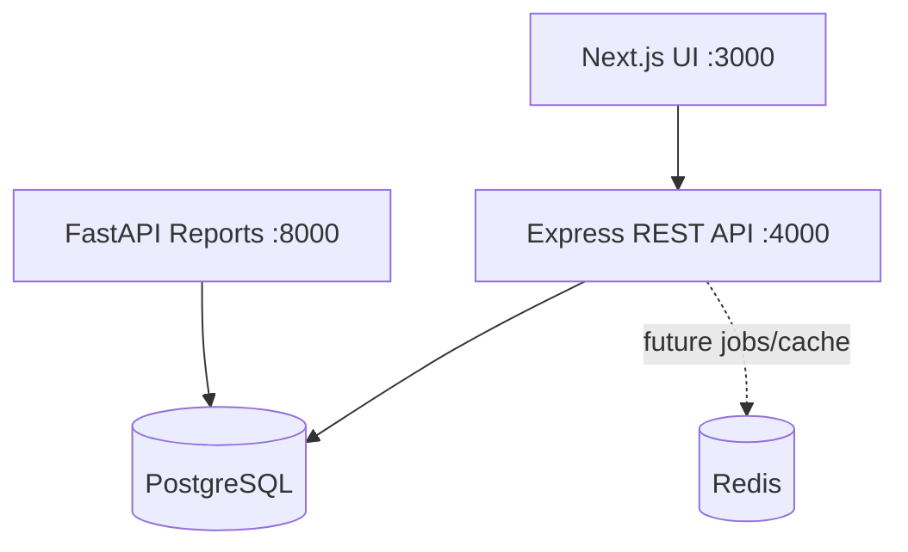

# Architecture

## Responsibilities
- Web UI: navigation, forms, tables, display states. It is not trusted for business validation.
- Express: authentication, authorization, CRUD and transactional workflow operations.
- PostgreSQL: system of record; foreign keys, unique constraints, and checks enforce basic integrity.
- FastAPI: read-only reporting and aggregate queries.
- Redis: infrastructure for future cache/queue use.

## Transaction examples
- PO creation inserts header, items, and approval in a transaction.
- Goods receipt updates stock, records movement, creates receipt, and changes PO status atomically.
- Sales fulfillment validates stock, decrements quantities, creates stock movements and invoice, and marks order fulfilled in a transaction.
- Payment locks invoice, prevents overpayment, records payment and updates invoice status.

## Local ports
| Service | Port |
|---|---:|
| Web | 3000 |
| Express | 4000 |
| FastAPI | 8000 |
| PostgreSQL | 5432 (internal Compose network only) |
| Redis | 6379 (internal Compose network only) |
